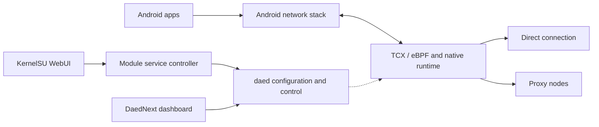

<div align="center">
  <h1>DaedNext-KernelSU</h1>
  <p><strong>A native transparent proxy module for ARM64 Android and KernelSU</strong></p>
  <p>Rust DaeNext core · DaedNext dashboard · Android networking integration</p>
  <p>
    <a href="https://github.com/Quan-0505/DaedNext-KernelSU/releases/latest"></a>
    <a href="https://github.com/Quan-0505/DaedNext-KernelSU/actions/workflows/android-check.yml"></a>
    
    <a href="LICENSE"></a>
  </p>
  <p><a href="README.md">简体中文</a> · <strong>English</strong></p>
  <p>
    <a href="https://github.com/Quan-0505/DaedNext-KernelSU/releases/latest">Download</a> ·
    <a href="#quick-start">Quick start</a> ·
    <a href="android/docs/BUILD.md">Build and upgrade</a> ·
    <a href="android/docs/VALIDATION.md">Validation</a> ·
    <a href="android/CHANGELOG.md">Changelog</a>
  </p>
</div>

> This project is in **alpha testing**. Compatibility is limited to the devices, system builds and scenarios covered by validation.

## Overview

DaedNext-KernelSU integrates the native Rust [DaeNext](https://github.com/ksong008/DaeNext) transparent proxy core into a KernelSU module, with the [DaedNext](https://github.com/ksong008/DaedNext) dashboard and a separate module WebUI.

The integration focuses on Android deployment: service lifecycle, system trust stores, policy routing, Wi-Fi/cellular transitions, and vendor-kernel behavior affecting eBPF and control traffic. The repository retains the complete Rust source and upstream history; Android integration lives in [`android/`](android/README.md).

## Features

| Capability | Description |
| --- | --- |
| Native traffic processing | Rust core with a TCX/eBPF data plane and configurable direct or proxy forwarding. |
| Two management interfaces | KernelSU WebUI for service controls and compatibility options; DaedNext for nodes, subscriptions, groups, DNS, routing and logs. |
| Service lifecycle | Start, stop, restart, reload, boot recovery, readiness checks and consistent backups. |
| Android networking | Automatic WAN selection, phone configurations without LAN interfaces, Android policy routing and network transitions. |
| Cellular fixes | Handles vendor QoS overwriting packet marks and namespace-ID collisions during runtime reconstruction. |
| System trust store | Generates a CA bundle from Android certificates; node TLS verification remains enabled by default. |
| Persistent data | Accounts, configuration, nodes and subscriptions are retained across updates and uninstall. |
| Optional Google compatibility | Maintains Google networking policies on the verified ColorOS framework and restores recorded values on stop; disabled by default. |

### Component overview



## Compatibility and validation

| Item | Current scope |
| --- | --- |
| Architecture | ARM64; not packaged for x86 or 32-bit ARM. |
| Root manager | KernelSU with module management, WebUI and its BusyBox; other managers are unverified. |
| Kernel capabilities | Compatible eBPF/TC, BTF, veth and network namespace support. Vendor restrictions can affect operation. |
| Verified device | OnePlus 13 / PJZ110, Android 17 / SDK 37. |
| Verified kernel | `6.6.118-android15` AGKI, SELinux Enforcing. |
| Validated version | Module `v0.1.0-alpha4`, core `3.1.0-android-ksu.3`. |

Validation covers standard KernelSU installation, cold boot, Wi-Fi → 5G transitions, application connectivity and Google policy restoration. Cellular checks for Google, YouTube, Telegram and domestic direct traffic passed; the user confirmed the Play Store homepage after reboot.

Vendor restrictions prevent cgroup attachment on the verified device, so avoid `pname()` process-name routing. Validation does not cover every UDP/QUIC or IPv6 scenario, other devices, Play Store installation flows or purchases. See [validation details](android/docs/VALIDATION.md).

## Quick start

### 1. Install

Download the ARM64 ZIP from the [latest release](https://github.com/Quan-0505/DaedNext-KernelSU/releases/latest), install it through KernelSU, then reboot.

Currently validated asset: [`DaedNext-KernelSU-v0.1.0-alpha4-arm64.zip`](https://github.com/Quan-0505/DaedNext-KernelSU/releases/download/v0.1.0-alpha4/DaedNext-KernelSU-v0.1.0-alpha4-arm64.zip). Releases distribute the installation ZIP only.

Stop other transparent proxy cores or VPNs before installation. The module checks for conflicting processes, but that check does not cover every possible competing proxy.

### 2. Configure and start the runtime

1. Open the **DaeNext** module WebUI in KernelSU and ensure the service is started.
2. Open the dashboard from the WebUI or visit **http://127.0.0.1:2023/** on the phone.
3. Create your own administrator account, add nodes or subscriptions, and configure groups, DNS and routing.
4. Start the proxy runtime in the dashboard and verify behavior with actual applications.

Packages contain no accounts, nodes or subscriptions. Initial routing is direct. The dashboard listens on loopback only. A reachable dashboard does not imply a running proxy runtime; inspect `readiness.runtimeRunning`.

### 3. Optional Google network compatibility

On the verified ColorOS framework, network transitions can restrict the Play Store and Google services. Enable **Google network compatibility** in the module WebUI if needed.

- Disabled by default; only manages the corresponding primary-user UIDs, without clearing accounts or application data.
- Maintains networking policies while the proxy runtime runs and restores recorded policies when the runtime/service stops or the option is disabled.
- Preserves policies changed externally; failed restorations retain their journal for a later retry.
- Requires the verified SDK and framework hash before any compatibility-policy write.

This is a device compatibility option, not a general Google services installer or certification tool. See the [module documentation](android/module/README.md#google-服务联网兼容alpha4).

## Operations

Common operations are available in the KernelSU WebUI. For command-line use, run the following in a **root shell**:

```sh
CTL=/data/adb/modules/daenext/bin/daenextctl
"$CTL" status
```

| Operation | Command |
| --- | --- |
| Start / stop | `"$CTL" start` / `"$CTL" stop` |
| Restart / reload | `"$CTL" restart` / `"$CTL" reload` |
| Consistent backup | `"$CTL" backup` |
| Logs / diagnostics | `"$CTL" logs` / `"$CTL" diagnose` |
| Enable / disable autostart | `"$CTL" autostart on` / `"$CTL" autostart off` |
| Enable / disable Google compatibility | `"$CTL" google-network on` / `"$CTL" google-network off` |

### Data layout

The internal module ID remains `daenext`; renaming the repository does not change installed paths.

| Path | Purpose |
| --- | --- |
| `/data/adb/modules/daenext/` | Module programs and WebUI. |
| `/data/adb/daenext/config/` | Database, configuration and product logs. |
| `/data/adb/daenext/assets/` | GeoIP / Geosite data. |
| `/data/adb/daenext/certs/` | CA bundle generated from the system trust store. |
| `/data/adb/daenext/logs/` | Service and startup logs. |
| `/data/adb/daenext/backups/` | Consistent backups created by the module. |

### Update, backup and recovery

- **Update:** back up first, install the new ZIP in KernelSU and reboot. The installer backs up existing data and stops the previous service.
- **Backup:** briefly stops the service for a consistent SQLite snapshot, then restores its previous running state.
- **Disable/uninstall:** stop the service first. Uninstall preserves the data directory and attempts to restore Google policies managed by the compatibility option.
- **Downgrade:** retain a validated package and backup, and check database compatibility before reverting. Do not overwrite a live database.

## Troubleshooting

| Symptom | Check |
| --- | --- |
| Dashboard works but applications do not | Runtime activation, healthy group candidates, DNS and routing. |
| A conflicting proxy process is reported | Stop the competing core or VPN before starting this module. |
| Brief interruption after a network change | Allow WAN selection, health checks and compatibility policies to recover; inspect readiness and logs. |
| Play Store homepage is offline | Check the compatibility option on supported builds, or application network permissions and DNS on other systems. |
| Startup fails with `pname()` rules | Remove process-name rules on the verified device, where cgroup attachment is unavailable. |
| Dashboard cannot be opened from another device | It binds to `127.0.0.1` by design. |

When filing an issue, include the device model, Android/kernel/KernelSU/module versions, network type and reproduction steps. Redact logs first. **Do not upload databases, subscription URLs, node credentials, tokens or personal screenshots.**

## Build and maintenance

| Resource | Contents |
| --- | --- |
| [Android integration](android/README.md) | Module, tools, patches and version locks. |
| [Build and upgrade guide](android/docs/BUILD.md) | Repackaging, Rust/panel builds and upstream merges. |
| [Validation](android/docs/VALIDATION.md) | Verified environment, results and limits. |
| [Changelog](android/CHANGELOG.md) | Android integration releases. |
| [GitHub Actions](https://github.com/Quan-0505/DaedNext-KernelSU/actions) | Source checks and a manual Android build workflow. |

After changing only module scripts or its WebUI, repackage with locked runtime inputs:

```sh
python android/tools/fetch-runtime.py
python android/tools/seed-defaults.py
python android/tools/package.py
```

Output is written to `android/dist/`. **Rust changes require a complete core rebuild first**; this sequence reuses the published core. Panel and upstream baselines are locked in [`android/upstream.lock.json`](android/upstream.lock.json). Android patches are already applied to the source tree.

Basic CI checks source, syntax and empty defaults. Manually built artifacts still require device validation before release.

## Upstream and licensing

| Component | Source | License |
| --- | --- | --- |
| Rust core | [ksong008/DaeNext](https://github.com/ksong008/DaeNext) | AGPL-3.0-only |
| Dashboard | [ksong008/DaedNext](https://github.com/ksong008/DaedNext) | MIT |
| KernelSU JavaScript SDK | [KernelSU](https://github.com/tiann/KernelSU) | Apache-2.0 |
| Android integration | This repository's `android/` directory | AGPL-3.0-only |

Thanks to the upstream projects and their contributors. See [LICENSE](LICENSE) and [third-party notices](android/module/licenses/THIRD_PARTY.md). Original upstream documentation is retained in [`docs/upstream/`](docs/upstream/).
