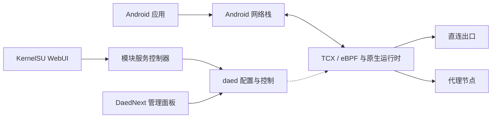

<div align="center">
  <h1>DaedNext-KernelSU</h1>
  <p><strong>面向 ARM64 Android 的 KernelSU 原生透明代理模块</strong></p>
  <p>Rust DaeNext 核心 · DaedNext 管理面板 · Android 网络适配</p>
  <p>
    <a href="https://github.com/Quan-0505/DaedNext-KernelSU/releases/latest"></a>
    <a href="https://github.com/Quan-0505/DaedNext-KernelSU/actions/workflows/android-check.yml"></a>
    
    <a href="LICENSE"></a>
  </p>
  <p><strong>简体中文</strong> · <a href="README.en.md">English</a></p>
  <p>
    <a href="https://github.com/Quan-0505/DaedNext-KernelSU/releases/latest">下载模块</a> ·
    <a href="#快速开始">快速开始</a> ·
    <a href="android/docs/BUILD.md">构建与升级</a> ·
    <a href="android/docs/VALIDATION.md">实测记录</a> ·
    <a href="android/CHANGELOG.md">更新日志</a>
  </p>
</div>

> 当前版本处于 **alpha 测试阶段**。兼容性以已验证的设备、系统和实测范围为准。

## 项目简介

DaedNext-KernelSU 将 [DaeNext](https://github.com/ksong008/DaeNext) 的 Rust 原生透明代理核心集成到 KernelSU 模块中，并提供 [DaedNext](https://github.com/ksong008/DaedNext) 管理面板和独立的模块 WebUI。

项目重点是 Android 环境下的部署与运行适配：服务生命周期、系统证书、策略路由、Wi-Fi/蜂窝切换，以及厂商内核对 eBPF 和控制流量的影响。完整 Rust 源码和上游提交历史保留在仓库中，Android 集中维护在 [`android/`](android/README.md)。

## 功能特性

| 能力 | 说明 |
| --- | --- |
| 原生流量处理 | 使用 Rust 核心及 TCX/eBPF 数据面接管流量，结合配置完成直连或代理转发。 |
| 双层管理界面 | KernelSU WebUI 管理服务与兼容选项；DaedNext 面板配置节点、订阅、策略组、DNS、路由与日志。 |
| 服务生命周期 | 提供启动、停止、重启、重载、开机恢复、状态检查与一致性备份。 |
| Android 网络适配 | 自动选择 WAN，使用 Android 策略路由同时监测 IPv4／IPv6，支持 Wi-Fi／蜂窝切换后的数据面恢复。 |
| Wi-Fi 自动切换 | 黑名单内直连、名单外代理；白名单反向。移动数据策略独立，保留手动停止意图。 |
| 节点健康检查 | 新安装默认每 50 秒检查；切网恢复立即重新探测。升级保留已有用户的间隔设置。 |
| 蜂窝网络修复 | 处理 QoS 改写数据包标记造成的自身流量回环，以及命名空间重建时的编号冲突。 |
| 系统信任库 | 从 Android 系统证书目录生成 CA bundle，默认保留节点 TLS 证书校验。 |
| 持久化数据 | 账户、配置、节点和订阅保存在独立数据目录；更新与卸载保留数据。 |
| 可选 Google 兼容 | 在已验证的 ColorOS 框架上维护 Google 服务联网策略，停止时按记录还原，默认关闭。 |

### 组件关系



## 兼容性与实测状态

| 项目 | 当前范围 |
| --- | --- |
| CPU 架构 | ARM64；安装包不面向 x86、32 位 ARM。 |
| Root 管理器 | KernelSU，需具备模块管理、WebUI 和配套 BusyBox；其他管理器未验证。 |
| 内核能力 | 需具备兼容的 eBPF/TC、BTF、veth 与网络命名空间支持；厂商限制会影响实际可用性。 |
| 已验证设备 | 一加 13 / PJZ110，Android 17 / SDK 37。 |
| 已验证内核 | `6.6.118-android15` AGKI，SELinux Enforcing。 |
| 当前实测版本 | 模块 `v0.1.0-alpha6`，核心 `3.1.0-android-ksu.5`。 |

alpha6 新增 Wi-Fi 黑白名单与独立的非 Wi-Fi 策略：指定网络可自动直连，离开后按原启用意图恢复代理。实机验证覆盖黑白名单命中与未命中、重复 Wi-Fi／5G 切换、手动停止及直连期间启动。alpha5 的普通热点切换和 alpha4 的冷启动记录分别保留；alpha6 本轮未重新验证冷启动。

当前设备的 cgroup attach 受到厂商内核限制，配置应避免 `pname()` 进程名路由。全部 UDP/QUIC、IPv6 场景、其他机型、Play 应用安装与付费购买不在本轮验收结论内。具体条件和证据摘要见 [实测记录](android/docs/VALIDATION.md)。

## 快速开始

### 1. 安装模块

从 [Latest Release](https://github.com/Quan-0505/DaedNext-KernelSU/releases/latest) 下载 ARM64 ZIP，在 KernelSU 管理器中选择本地安装，完成后重启。

当前实测安装包：[`DaedNext-KernelSU-v0.1.0-alpha6-arm64.zip`](https://github.com/Quan-0505/DaedNext-KernelSU/releases/download/v0.1.0-alpha6/DaedNext-KernelSU-v0.1.0-alpha6-arm64.zip)。Release 只提供安装 ZIP。

安装前停止其他透明代理核心或 VPN，避免重复接管流量。模块包含冲突检测，但不能代替对其他代理状态的检查。

### 2. 创建配置并启动内核

1. 在 KernelSU 的 **DaeNext** 模块条目中打开 WebUI，确认服务已启动。
2. 点击“打开管理面板”，或在手机浏览器访问 **http://127.0.0.1:2023/**。
3. 首次使用创建自己的管理账户，添加节点或订阅，并配置策略组、DNS 和路由。
4. 在管理面板中启动内核，再用实际应用检查代理与直连行为。

安装包默认不含账户、节点和订阅，初始规则为直连。管理面板仅监听本机，面板可访问不代表透明代理内核已经运行；可通过状态中的 `readiness.runtimeRunning` 区分。

### 3. 按需启用 Google 服务联网兼容

如果已验证的 ColorOS 系统在切换网络时限制 Play 商店与 Google 服务联网，可在模块 WebUI 中启用 **Google 服务联网兼容**。

- 默认关闭，仅针对商店和 Google 服务对应的主用户 UID；不清除账户或应用数据。
- 内核运行或用户仍启用内核的 Wi-Fi 策略直连期间维护联网策略；手动停止内核、停止服务或关闭选项时按记录还原。
- 已被外部修改的策略会保留；恢复失败时保留原策略记录以便重试。
- 仅允许匹配已验证 SDK 与框架哈希的系统执行写入；不匹配的系统不会自动套用。

这是设备适配选项，不是通用的 Google 服务安装或认证工具。实现与适用条件见 [模块说明](android/module/README.md#google-服务联网兼容alpha4)。

### 4. 按需设置 Wi-Fi 自动切换

在模块 WebUI 打开 **Wi-Fi 自动切换**，选择黑名单或白名单，按每行一个 SSID 填写并保存。黑名单中的 Wi-Fi 使用手机直连，其他 Wi-Fi 使用原有代理规则；白名单模式相反。移动数据由“非 Wi-Fi 网络使用代理”独立控制，默认开启。

功能默认关闭且名单为空。策略直连时面板保持运行，`readiness.networkPolicyPaused` 为 `true`，数据面停止；离开该网络后仅在用户原来启用内核时恢复。手动停止不会被切网覆盖。详细行为见 [Wi-Fi 自动切换](android/docs/WIFI-POLICY.md)。

## 日常管理

常用操作可直接在 KernelSU WebUI 中完成。以下命令需在 **Root shell** 执行：

```sh
CTL=/data/adb/modules/daenext/bin/daenextctl
"$CTL" status
```

| 操作 | 命令 |
| --- | --- |
| 启动 / 停止服务 | `"$CTL" start` / `"$CTL" stop` |
| 重启服务 / 重载配置 | `"$CTL" restart` / `"$CTL" reload` |
| 一致性备份 | `"$CTL" backup` |
| 查看日志 / 诊断 | `"$CTL" logs` / `"$CTL" diagnose` |
| 开启 / 关闭开机启动 | `"$CTL" autostart on` / `"$CTL" autostart off` |
| 开启 / 关闭 Google 兼容 | `"$CTL" google-network on` / `"$CTL" google-network off` |

### 数据目录

内部模块 ID 保持为 `daenext`，仓库名称变更不改变既有安装和数据路径。

| 路径 | 用途 |
| --- | --- |
| `/data/adb/modules/daenext/` | 模块程序与 WebUI。 |
| `/data/adb/daenext/config/` | 数据库、配置和产品日志。 |
| `/data/adb/daenext/wifi-policy.json` | Wi-Fi 自动切换设置，升级保留并纳入备份。 |
| `/data/adb/daenext/assets/` | GeoIP / Geosite 资源。 |
| `/data/adb/daenext/certs/` | 从系统信任库生成的 CA bundle。 |
| `/data/adb/daenext/logs/` | 服务及启动日志。 |
| `/data/adb/daenext/backups/` | 模块生成的一致性备份。 |

### 更新、备份与回退

- **更新**：先备份，再在 KernelSU 中安装新 ZIP 并重启；安装器会备份既有数据并停止旧服务。
- **备份**：备份操作会短暂停止服务以一致地保存 SQLite 数据，再恢复此前的服务运行状态。
- **停用或卸载**：先停止服务；卸载保留数据目录，Google 兼容按记录还原其管理的策略。
- **版本回退**：保留已验证的安装包和备份，确认数据格式兼容后再回退；不要向运行中的数据库直接覆盖文件。

## 常见问题

| 现象 | 排查方向 |
| --- | --- |
| 面板打开，但应用仍不通 | 检查内核是否启动、策略组是否有可用候选，以及 DNS / 路由配置。 |
| 提示存在其他代理进程 | 先停止对应代理或 VPN，再启动本模块。不要同时运行多个接管核心。 |
| 切换网络后短暂不可用 | 等待 WAN、节点健康检查和兼容策略恢复，结合状态与日志判断。 |
| Google Play 首页离线 | 在支持的系统上检查 Google 兼容选项；其他系统先检查应用联网权限与解析。 |
| 配置了 `pname()` 后启动失败 | 当前验证设备的 cgroup attach 不可用，移除进程名规则后重试。 |
| 管理面板无法从另一台设备访问 | 面板仅绑定 `127.0.0.1`，这是当前设计行为。 |

提交问题时请提供设备型号、Android/内核/KernelSU/模块版本、网络类型和复现步骤。日志应先脱敏，**不要上传数据库、订阅 URL、节点凭据、令牌或个人截图**。

## 构建与维护

| 入口 | 内容 |
| --- | --- |
| [Android 集成目录](android/README.md) | 模块、工具、补丁及版本锁定说明。 |
| [构建与升级](android/docs/BUILD.md) | 重新打包、编译 Rust 核心与面板、合并上游更新。 |
| [实测记录](android/docs/VALIDATION.md) | 当前设备、测试结果与适用边界。 |
| [更新日志](android/CHANGELOG.md) | Android 集成的版本变化。 |
| [GitHub Actions](https://github.com/Quan-0505/DaedNext-KernelSU/actions) | 基础源码检查及手动 Android 构建入口。 |

仅修改服务脚本或模块 WebUI 时，可复用锁定的运行时输入重新打包：

```sh
python android/tools/fetch-runtime.py
python android/tools/seed-defaults.py
python android/tools/package.py
```

输出位于 `android/dist/`。**修改 Rust 源码后必须先完整编译核心**；上述流程会复用已发布核心。面板和上游基线由 [`android/upstream.lock.json`](android/upstream.lock.json) 固定，Android 补丁已包含在源码中，无需重复应用。

基础 CI 检查源码、语法与空白默认数据库；手动构建产物仍需进行实机验收后再发布。

## 上游与许可证

| 组件 | 来源 | 许可证 |
| --- | --- | --- |
| Rust 核心 | [ksong008/DaeNext](https://github.com/ksong008/DaeNext) | AGPL-3.0-only |
| 管理面板 | [ksong008/DaedNext](https://github.com/ksong008/DaedNext) | MIT |
| KernelSU JavaScript SDK | [KernelSU](https://github.com/tiann/KernelSU) | Apache-2.0 |
| Android 集成 | 本仓库 `android/` | AGPL-3.0-only |

感谢上游项目及其贡献者。完整许可证见 [LICENSE](LICENSE)，组件说明见 [第三方声明](android/module/licenses/THIRD_PARTY.md)；上游原始说明保存在 [`docs/upstream/`](docs/upstream/)。
